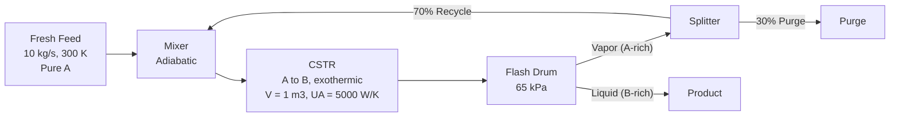

# Physics-Validated Multi-Agent Control Prototype

A Python simulation prototype of a refinery-style process plant
(Fresh Feed -> Mixer -> CSTR -> Flash Drum -> Splitter -> Recycle loop).
Agents propose setpoint changes; a physics-based validation layer checks each
proposal against mass balance, energy balance and safety limits before it is
accepted.

Developed as a concept for the **HMEL i-Quest 2026** competition (abstract
submitted; not shortlisted for the next round). This is an independent student
project and is not affiliated with or endorsed by HMEL.

## Status: simulation prototype

| Component | Status |
|---|---|
| Exothermic CSTR model (Arrhenius kinetics, steady-state mass and energy balance) | Implemented |
| Flash drum (Rachford-Rice with Clausius-Clapeyron vapor pressures) | Implemented |
| Plant-wide solver with recycle (tear-stream iteration) | Implemented |
| Rule-based agents proposing setpoints, with physics validation of each proposal | Implemented |
| Bayesian fusion of noisy sensor readings with the physics prediction | Implemented |
| Neural-network surrogate (physics-informed neural operator) | **Not implemented. Planned future work.** |
| DWSIM integration | Optional bridge; the analytical engine is used when DWSIM is absent |

The "physics engine" that validates proposals is an **analytical solver**, not a
trained neural operator. There is no machine-learning code in this repository.

## Plant topology



## What the scenarios show

Both scenarios are steady-state calculations (no time dynamics).

1. **Single unit (`piml_multiagent_sim.py`)**: feed pressure drop plus a noisy
   temperature sensor. A proposal of 405.5 K is rejected for exceeding the
   400 K runaway limit; a revised proposal is accepted.
2. **Plant-wide (`multiobjective_piml_sim.py`)**: 40% loss of cooling capacity
   (UA 5000 -> 3000 W/K). An initial proposal is rejected because flash vapor
   exceeds the 1.5 kg/s compressor limit. Among five hand-picked candidate
   setpoint sets, the most profitable one that passes all checks is selected,
   holding the reactor at about 366 K (limit 400 K).

## Limitations

- The "standard AI" and "manual control" cases are **scripted scenarios** for
  illustration (fixed actions and fixed recovery times), not trained models or
  measured benchmarks. No speed or performance comparison should be read from them.
- Reported recovery times are simulated timestamps, not measured run times.
- Candidate selection is a search over five hand-picked points, not a Pareto
  optimization.
- In `piml_multiagent_sim.py`, the approved heater setpoint is not fed back into
  the plant model; only the coolant change is applied.
- In `plantwide_piml_sim.py`, the CSTR energy-balance check is diagnostic only
  and always passes; the mass-balance checks hold by construction of the solver.
- Economic parameters (prices, penalties) and the reaction parameters are
  illustrative values, not real plant data.

## Planned future work

- Dynamic reactor model with `scipy.integrate.solve_ivp`, so thermal runaway
  can be simulated over time.
- A physics-informed neural-network surrogate trained on solver data, with
  measured accuracy, speed and unsafe-action detection rate.
- Replace the scripted baselines with real controllers.

## Project structure

- `src/dwsim_cstr_plant.py`: CSTR model and optional DWSIM bridge.
- `src/piml_multiagent_sim.py`: single-unit agent and validation loop.
- `src/plantwide_model.py`, `src/plantwide_topology.py`: plant-wide solver.
- `src/plantwide_piml_sim.py`: plant-wide agent and validation loop.
- `src/multiobjective_piml_sim.py`: multi-objective (economics, energy, environment) scenario.

## Running

```
pip install -r requirements.txt
python src/piml_multiagent_sim.py
python src/multiobjective_piml_sim.py
```

DWSIM is optional. If it is not installed, the analytical engine is used automatically.
